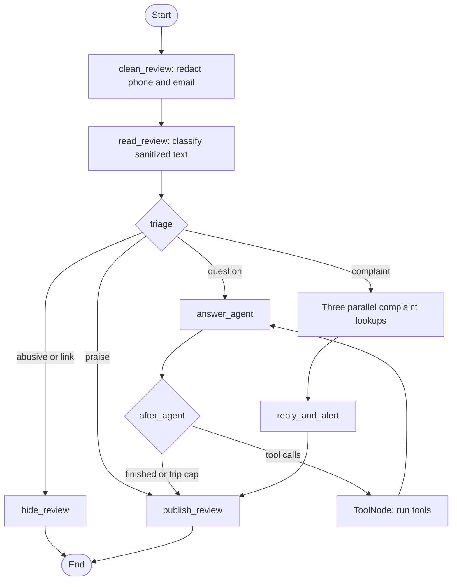

# Hopscotch Review Moderation

A LangGraph sample application that moderates product reviews, routes customer questions to an LLM with read-only tools, and gathers complaint evidence in parallel.

## Requirements

- Python 3.10 or newer
- An OpenRouter API key for model-backed review processing

## Setup

From the project root, create and activate a virtual environment, then install the dependencies:

```bash
python3 -m venv .venv
source .venv/bin/activate
python -m pip install -U "langgraph>=1.0,<2.0" "langchain-core>=1.0,<2.0" langchain-openai python-dotenv
```

Create a `.env` file next to this README and add your key:

```dotenv
OPENROUTER_API_KEY=your_openrouter_api_key
```

Keep the key private and do not commit `.env`.

## Run

With the virtual environment activated, run:

```bash
python -m reviewMod.run
```

The app processes the seven sample reviews and prints each review's classification and final status. It makes model requests through OpenRouter. For the notebook, run its `%pip install ...` setup command in a Python notebook cell, not in the zsh terminal.

## Workflow



Phone numbers and email addresses are redacted before review text reaches the model. Complaints run three independent lookups concurrently. Question tools retrieve size charts, care instructions, and stock information; the agent loops until it has an answer or reaches its trip limit.

## Project layout

- `reviewMod/state.py`: shared `ReviewState` definition.
- `reviewMod/model.py`: lazy OpenRouter model setup and tool binding.
- `reviewMod/schemas.py`: structured classification output.
- `reviewMod/routers.py`: triage and tool-loop routing rules.
- `reviewMod/tools.py`: read-only tools for customer questions.
- `reviewMod/data.py`: in-memory product, complaint, batch, vendor, size, care, and stock data.
- `reviewMod/stores.py`: in-memory moderation, published-review, and quality-alert destinations.
- `reviewMod/nodes/`: one module per graph node.
- `reviewMod/graph.py`: LangGraph nodes, edges, parallel join, and tool loop.
- `reviewMod/run.py`: command-line entry point and sample review runner.
- `reviewMod/review.py`: sample reviews and optional notebook graph display helper.
- `Tech_LangGraph_Guided-Project_Hopscotch_ReviewModeration.ipynb`: guided notebook version of the project.

The product data and destination stores are in-memory examples; they reset when the process exits.